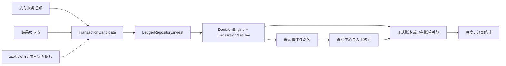

# V2 数据与识别架构

更新于 2026-10-14。本文描述当前 V2 工作树的实现和边界；首次公开源码快照、历史 1.1 APK 与后续 V2 交付是不同版本。实际构建、测试数量和设备验证以版本对应的验证记录为准，不从类名、测试夹具或计划功能推定已交付。

## 模块与统一入口

主工程使用 Kotlin、Jetpack Compose、Material 3 和 Android SQLite。`domain` 负责精确金额、凭据语义及统计；`recognition` 负责归一化候选、判定、状态迁移和关联；`automation` 负责通知、节点与设备端 OCR；`data` 负责事务、设置、迁移和备份；`ui` 负责账本、识别中心、确认编辑、分类规则与回收站。

通知、无障碍节点、自动 OCR 和系统选择器导入图片都生成 `TransactionCandidate`，通过 `ingest(candidate, stillValid)` 进入同一条仓库事务路径。旧 `addNotification` / `addScreenPayment` 是兼容适配器，不保留独立的自动写账路径。手动记账直接创建明确的账本记录，但使用相同金额、方向、退款和事务约束。

采集阶段只在内存保留读取到的文字和几何信息。候选记录来源、证据通道、整数分金额、经济类型、方向、交易及观察时间、完成状态、稳定身份、金额候选、规则版本和固定解释。单号原文只在解析与计算身份时暂存，入库使用包含来源及单号命名空间的哈希。

备份 `BackupControls` 已接入系统文件选择器，先验证密码与结构并展示预览，再二次确认覆盖。本次没有 Android `ACTION_SEND` 图片分享接收入口；`SHARED_IMAGE` 是预留候选类型，不属于已交付采集通道。图片导入使用系统选择器，不能据枚举声称可以从其它应用直接分享至轻记。

## 七张数据表

| 表 | 角色与关键关系 |
| --- | --- |
| `entries` | 已入账记录，兼容保留旧版待确认账单。金额整数分；包含方向、经济类型、用户修改标记、不可编辑采集来源与 `deleted_at`。退款的 `related_entry_id` 指向原消费。新 REVIEW 候选不在这里创建第二笔待确认账单。 |
| `source_events` | 识别事实、完成状态、AUTO / REVIEW / IGNORE 决定、规则版本、固定理由和单号哈希。`linked_entry_id` 指向对应账单，`suggested_entry_id` 表示待核对建议，`related_entry_id` 表示退款原消费。多个来源事件可指向同一账单。 |
| `event_aliases` | 一个事件可有多个通知版本或证据身份哈希。每个别名指向 `source_events.id`，避免更新通知生成多笔来源。 |
| `seen_events` | 已处理事件哈希与观察时间。保留没有活跃账单或来源的旧墓碑，删除或忽略不会移除身份历史。 |
| `merchant_rules` | 按来源、规范化商户与支出 / 收入方向记住用户分类选择；转账、还款与未确认来源不会自动污染规则。 |
| `link_actions` | 自动关联、人工关联、撤销关联、确认、忽略和撤销忽略的操作历史；保留来源及前后账单 ID。 |
| `recognition_diagnostics` | 按证据通道记录最近成功、失败、固定失败原因和耗时，不包含原图或识别全文。 |

正式账本与来源事实分离：自动识别产生 REVIEW 时，识别中心显示来源候选，正式统计不增加。确认新记录、关联已有记录、忽略或撤销关联都由仓库在事务内重新核对最新来源、金额、方向和关联目标，并记录操作历史。用户已编辑的金额、类型、日期、商户或备注不会被自动识别覆盖。

## 决策、身份与可撤销关联

`DecisionEngine` 自动入账的前提是支持来源、合法金额、交易已完成、经济类型和方向一致、稳定身份、单一金额、合理时间及无重复冲突。失败、待付款、取消等证据忽略；OCR / 导入图片、未知类型、转账、还款、历史时间、无稳定身份及多金额进入 REVIEW。退款还必须定位唯一有效原消费并有剩余可退款金额。

事件指纹只标识来源观察，不等于跨通道订单身份。跨通知 / 节点的强关联需要来源相同、单号命名空间和单号哈希相同，金额、方向、经济类型与已确认账单一致，且双方为已完成的可信通知或节点证据。它添加新的来源关联，不创建或改写第二笔账单。退款的原订单标识只用于寻找原消费，不冒充退款自身的单号。

没有可靠共同单号时，只比较同金额、方向、经济类型、兼容来源、规范化商户和最多两分钟的交易时间邻近性；结果是人工关联建议。不同可靠单号的同价交易保持独立。已删除或人工忽略的稳定订单有持久抑制；时间身份升级或弱重复则保守进入核对，不能以金额相等作为永久合并依据。超出规则窗口或证据缺时间的重复无法保证被发现。

已人工忽略的事件不会被后续自动凭据解除，须用户主动撤销忽略。已完成状态不被迟到的失败 / 待完成事件逆转；未完成证据可由新的完成证据补充。人工撤销关联标记为 `DETACHED`，不会因再次看到同一页面而自动重新关联。冲突来源不修改其已关联的正式账单，需要修改账单或明确撤销 / 重做关联。

## 经济类型与统计

`EntryType` 表示资金流向（EXPENSE / INCOME），`BusinessType` 表示经济含义：消费、收入、转账、退款、还款、未知。收到资金不必然是收入，向个人转账不必然是消费；用途不明确时需要用户核对。转账和还款可被确认作为资金往来记录，但不重复计入消费或新增收入。未知与未确认记录不计入正式统计。

只有已确认、未删除的消费进入消费总额，只有已确认收入进入收入。正式退款必须是 INCOME 方向并关联一笔活跃、已确认的 EXPENSE 消费，累计有效退款不能超过原消费金额。退款在其发生月份减少净消费，并按原消费分类抵扣，不增加收入；跨月退款可使某月净消费为负。余额按收入减净消费计算。

`LedgerStatistics` 接收当前统计期间的活跃记录及完整活跃账本来定位跨月原消费；对退款额度按发生时间与 ID 排序累计封顶。仓库在创建、确认、编辑和恢复时也检查原消费及累计退款，防止修改原单使已确认退款超额。

删除使用软删除，回收站保留行及身份历史。删除原消费时其已确认退款暂停统计并进入核对；恢复原消费会重新检查其关联退款的可用性。具体恢复与人工忽略状态在同一事务内处理，未经校验的关联退款不会作为新增收入计入。

CSV 保留原有日期、资金方向、金额、分类、商家、备注、来源和待核对八列，末尾追加“经济类型”和“关联原消费ID”。经济类型使用稳定枚举 `EXPENSE / INCOME / TRANSFER / REFUND / REPAYMENT / UNKNOWN`；退款保留对应原消费的本机账单 ID，其它记录原消费 ID 为空。原“类型”列只表示资金转入或转出，统计消费时还须区分经济类型，不能把退款当新增收入或把内部转账、还款当重复消费。CSV 仍保留 UTF-8 BOM、引号转义及表格公式防护；它不包含完整来源事件、身份历史和设置，不能代替完整加密备份，也不提供 CSV 恢复。

## 并发、撤销与初始化

数据库写入运行在 IO 调度器，使用仓库 `Mutex` 串行事务。来源事件、别名、墓碑、账单及操作日志在同一 SQLite 事务内提交。入库前和提交前均检查来源开关与 `stillValid`；队列中的观察绑定配置版本、服务会话及窗口修订，切换页面、关闭来源、撤销服务或开始恢复后不能继续使用旧结果。

`settingsLock` 同步账本设置与备份操作，配置变化递增 generation。通知还要求晚于当前授权启用与服务连接门槛；不回扫历史。节点读取先做页面元数据 / 有界标题门禁，再读取交易字段；OCR 全进程串行、有限像素和耗时指标、自动截图至少八秒间隔。更多采集细节见 [隐私边界](privacy.md)。

仓库初始为 `restoreBlocked=true`。初始化在任何账本刷新或自动采集前调用 `retryPendingRestore`：无检查点才正常读取；有检查点则先恢复原数据库与设置。损坏检查点、数据库或设置提交失败会保留阻止状态，不清空数据或静默继续采集。状态、诊断和固定错误通过 StateFlow 提供给 UI。

## 完整备份与恢复

`LedgerBackupCoordinator` 在仓库 mutex 内调用；`BackupStorage` 只使用固定表名、字段白名单与 ContentValues。快照格式为 `formatVersion=2`、`schemaVersion=3`，包含七表、创建时间和六项设置，保留旧待确认行、软删除行、全部别名和去重墓碑。单个明文快照上限 16 MiB，每表最多十万行，总行数最多二十万，主键 / 外键上限为 `2^53-1`；浮点或指数金额不会截断为整数分。

`EncryptedBackupCodec` 使用 AES-256-GCM、随机 16 字节盐、随机 12 字节 nonce、128 位认证标签及 PBKDF2-HMAC-SHA1 300,000 次派生。固定受限头部也参与认证，版本、算法、迭代次数和长度在派生密钥前检查。API 24 兼容路径不依赖较新系统才提供的 PBKDF2 SHA-256 算法。新导出密码至少八个字符；不存储密码，内部临时派生材料会清理，调用方负责清理其密码和文件字节数组。

恢复先认证解密，再通过 `BackupDocumentValidator` 检查完整结构、严格整数、字段范围、枚举、唯一主键、外键、别名 / 墓碑关系及退款累计额度。`PreparedRestore` 只持有私有明文副本及不可变计数预览，与调用方文件字节后续变化隔离；确认后消费一次，成功或失败都销毁。预览或密码失败阶段不改数据库。

用户确认覆盖后先暂停采集，导出当时最新原账本及设置并写入独立于数据库名称的私有 `RestoreJournal`。检查点用 `AtomicFile`、固定版本 / 长度和 SHA-256，写完重新读取验证后才开始替换。它是与 SQLite 同范围的私有提取字段快照，没有原截图或通知全文，也不是对外导出的明文备份。

数据库替换是完整 SQLite 事务：先删除子表后删除账单，先以空原单关联插入全部账单，再补齐退款自关联，最后恢复其它固定表；三个自增表的内部编号计数器重置为本表恢复后的最大 ID，避免旧异常高水位阻止以后新增记录。提交前执行 `foreign_key_check` 和 `quick_check`。保留导入的真实主键及关联，不关闭外键、不删除数据库文件、不执行文件中提供的 SQL。

主键范围存在一个极端构造边界：合法导入 ID 恰为 `2^53-1` 后，新行仍可由 SQLite 分配更大 ID，但已超出本格式的校验范围，后续完整导出会被拒绝。由于恢复流程必须先生成有效原快照，应用中的覆盖恢复也会在开始替换前被阻止。当前不对这种构造状态自动重新编号或绕过校验；真实账本正常生成的编号不会自然逼近该量级。[SQLite 官方说明](https://www.sqlite.org/autoinc.html)解释了自增高水位及其内部计数表的行为。

数据库恢复后同步 `commit` 六项设置：保留预算和微信 / 支付宝选择，关闭通知、屏幕、自动 OCR 三个开关并移除旧启用时间；系统权限不恢复。刷新账本且清除检查点后才成功。任一步失败会尝试回滚覆盖前数据库及六项设置；原通知开关若开启，使用当前时间的新门槛。回滚或检查点清除仍失败时保留检查点及暂停状态，提供显式重试，不无限循环。

## 从数据库 1 / 2 迁移到 3

迁移为追加列及新表，不重建或清空历史账本。版本 1 先补不可编辑 `capture_kind`；版本 1、2 均补经济类型、退款原单、人工修改及软删除列，再建来源事件、别名、规则、关联日志和诊断表。原整数分、方向、分类、商户、备注、时间、事件指纹及所有墓碑保留。

旧自动账单生成 `LEGACY` 来源事件，原待确认标记对应 REVIEW，原已确认记录继续保留。旧版没有保存的真实订单身份不从备注猜测。旧业务类型按原支出 / 收入方向初始化；例如原“退款”分类收入不会被擅自重分类或关联原消费。原先已经物理删除且只剩墓碑的记录不会因升级恢复。

## 验证与未承诺范围

纯 Kotlin 测试覆盖金额、语义、OCR 布局、决策和匹配；Android 隔离测试覆盖迁移、事务、关系、统计、备份、检查点及 UI。专用通知 / 页面夹具使用固定合成数据和独立模拟器，不安装到已有真实支付应用的个人手机。具体通过数字与实际交付证据由对应验证文档记录。

尚未提供完整账户资产 / 负债总账、银行直连、云同步、CSV 恢复、`ACTION_SEND` 图片分享入口或任意第三方支付版本的保证覆盖。备份 API 与系统选择器 UI 已接入当前 V2 工作树，最终可用性由对应交付 APK 的验证记录确认，旧 1.1 APK 不包含这套完整恢复流程。三星生活助手机制未被源码确认；本项目实现不等于对该产品的复刻验证。
